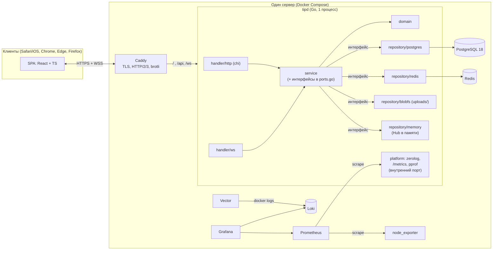
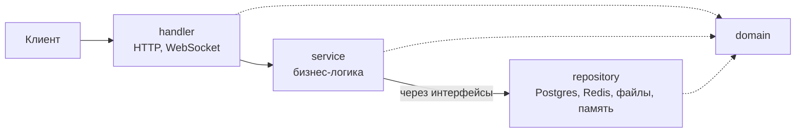
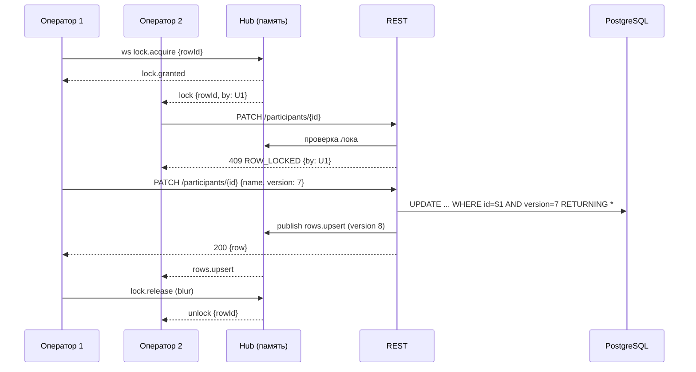
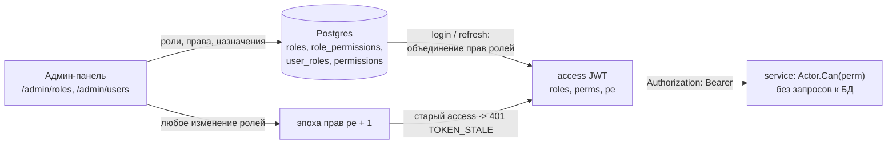

# 02. Архитектура

## 1. Обзор

Монолит, построенный по **Clean Architecture** с цепочкой **`handler → service → repository`**: один Go-бинарник `tipd` отдаёт REST API, WebSocket и встроенный SPA.
Бизнес-логика (`service`) не знает ни про HTTP, ни про Postgres, ни про файловую систему: транспорт — это `handler`, хранение — `repository`,
а связь между слоями идёт через интерфейсы, которые объявляет сам `service` (раздел 3).
Внешние зависимости: PostgreSQL, Redis (все токены: refresh и отзыв JWT) и локальный диск (картинки). Всё остальное — инфраструктура вокруг (прокси, наблюдаемость).



### Принципы
1. **Clean Architecture: `handler → service → repository`.** Зависимости идут внутрь (`handler → service → domain`, `repository → domain`), `service` не импортирует `repository`
   и работает с хранилищем через свои интерфейсы. Правило проверяется в CI (раздел 3), а не соглашением.
2. **Простота прежде всего.** Монолит, без брокеров и очередей; Redis — только под токены (refresh и отзыв JWT), в Postgres токенов нет; ручная сборка зависимостей без DI-фреймворка. Состояние realtime — в памяти процесса.
3. **Запись — только через REST.** WebSocket — канал доставки событий, присутствия и блокировок. Валидация, права и аудит едины (один метод `service` на действие, вызывается и из HTTP-, и из WS-`handler`).
4. **Права — в `service` и едут в токене.** Роли и их права лежат в БД и настраиваются админом; при входе/обновлении пары права упаковываются в access-JWT, `service` проверяет `Actor.Can(perm)` без обращения к БД. `handler` не знает про роли и только передаёт `Actor`.
5. **Один экземпляр — осознанное ограничение.** Hub и локи живут в памяти. Если понадобится 2+ реплики — заменить реализацию `repository/memory` (интерфейс тот же), например на Postgres `LISTEN/NOTIFY`; `service` не меняется.
6. **Наблюдаемость — часть продукта** с первой фазы, с жёсткой ретенцией. Логирует только `handler` (и фоновые задачи в `main`); `service`/`repository` возвращают ошибки.

## 2. Технологический стек

### Backend
| Назначение | Выбор | Примечание |
|---|---|---|
| Язык | **Go 1.27.x** (последний стабильный) | `go.mod` фиксирует версию |
| HTTP-роутер | `net/http` + `go-chi/chi/v5` | Стандартный `http.Handler`; метрики/pprof/httptest без адаптеров |
| JWT | `golang-jwt/jwt/v5`, **HMAC-SHA256 (HS256)**, `WithValidMethods`; отдельные секреты для access и refresh | Только в `platform/security`; `service` видит интерфейс `TokenIssuer` |
| Хранилище токенов | **Redis** + `redis/go-redis/v9` | «Сожжённые» refresh и отзыв JWT; только в `repository/redis`; интерфейс `TokenStore` объявлен в `service`; ключи с TTL, атомарный `SET NX`, AOF, `noeviction` |
| CSRF | `Authorization: Bearer` для API (CSRF-неуязвим) + `CrossOriginProtection` и `SameSite=Strict` для единственного cookie-эндпоинта `/auth/refresh` | |
| WebSocket | `coder/websocket` | context-aware, проверка Origin из коробки; `permessage-deflate` выключаем |
| БД-драйвер | `database/sql` + `jackc/pgx/v5/stdlib` | Без ORM; SQL — константы рядом с репозиторием |
| Миграции | `pressly/goose/v3` (provider API, `go:embed`) | Запуск при старте (`AUTO_MIGRATE`) под advisory-lock |
| Пароли | `golang.org/x/crypto/argon2` (argon2id, m=19 МиБ, t=2, p=1) + pepper (HMAC-SHA256, секрет `PASSWORD_PEPPER`) | В БД — только необратимый хэш (PHC-строка); параметры OWASP-минимума ради RAM; семафор на 2 одновременных хэша; перехэширование при входе, если параметры изменились |
| API-контракт | **OpenAPI 3.1** (`backend/api/openapi.yaml`) + `oapi-codegen` (DTO + `ServerInterface` для chi) + **Swagger UI** (embed) | Contract-first; TS-типы для фронта из той же спецификации |
| Изображения | `image/*` stdlib + `golang.org/x/image/draw` | Чистый Go, без cgo; ресайз аватаров, проверка картинок проектов |
| XLSX | `xuri/excelize/v2` | Экспорт/импорт |
| Логи | **`rs/zerolog`** (JSON) + `zerolog/diode` | Почти нулевые аллокации; неблокирующая запись в stdout; сэмплинг шумных событий (см. `05-observability.md`) |
| Архитектурные проверки | `golangci-lint` + `depguard` | Запрещённые импорты по слоям, в CI |
| Метрики | `prometheus/client_golang` | `/metrics` на внутреннем порту |
| ID | UUIDv7 (`DEFAULT uuidv7()` в PG 18) | Сортируемые, не перечисляются |
| Тесты | `testing`, `httptest`, `testcontainers-go` (Postgres, Redis), `go test -race` | |
| Качество | `golangci-lint`, `govulncheck` | в CI |

### Frontend (подробности — `06-frontend.md`)
Vite + React + TypeScript, React Router, TanStack Query (серверное состояние), TanStack Virtual (таблица),
`openapi-typescript` (типы из контракта), `fflate` (ZIP), `@fontsource/*` (шрифты self-host),
Vitest + Testing Library, Playwright (Chromium/Firefox/WebKit), Biome.

### Инфраструктура
Docker Compose · Caddy · PostgreSQL 18 · Prometheus · Loki · Vector · Grafana (метрики + логи) · node_exporter · rclone (выгрузка бэкапов вне сервера).

## 3. Слои: handler → service → repository

Clean Architecture в минимальном виде: запрос всегда идёт одним путём, а лишних слоёв и пакетов нет.



| Слой | Что делает |
|---|---|
| **handler** | Принимает запрос, разбирает DTO, достаёт `Actor` из JWT, вызывает **один** метод service, превращает результат или ошибку в HTTP-ответ / WS-кадр |
| **service** | Вся бизнес-логика: права (`Actor.Can`), правила, транзакции, аудит, события. Хранилище видит только через **интерфейсы**, объявленные в самом service |
| **repository** | Всё, что хранит данные: SQL (Postgres), Redis (токены), файлы (картинки), память (локи и presence). Только запросы, без бизнес-решений |
| **domain** | Сущности, каталог прав, `Actor.Can`, доменные ошибки. Только stdlib |

Правила (всего четыре):
1. **Зависимости идут внутрь:** `handler → service → domain`, `repository → domain`. `service` **не импортирует** `repository`: интерфейсы лежат в `service/ports.go`, repository их реализует, склеивает всё `main`.
2. **handler не ходит в repository напрямую** — только через service (права и аудит живут в service).
3. **service не знает про HTTP, SQL, Redis, JSON, zerolog**; **handler не содержит логики**; **repository не содержит бизнес-решений**.
4. Нарушение правил ловит CI (`depguard`: `domain` — только stdlib, `service` — только `domain`).

### 3.1 Структура репозитория

```
tip_website/
├─ backend/
│  ├─ cmd/tipd/main.go         # запуск, чтение конфига и ручная сборка зависимостей
│  ├─ api/openapi.yaml         # контракт API (OpenAPI 3.1), Swagger UI на /api/docs
│  ├─ migrations/              # goose, *.sql
│  └─ internal/
│     ├─ domain/               # сущности, права, ошибки
│     ├─ service/              # auth.go users.go roles.go projects.go participants.go collab.go audit.go + ports.go
│     ├─ handler/              # http/ (chi, gen/ из openapi), ws/
│     ├─ repository/           # postgres/, redis/, blobfs/, memory/ (Hub: локи, presence)
│     └─ platform/             # технические кирпичи: config, logging, metrics, db, security (JWT, argon2), imaging, sheets
├─ frontend/                   # Vite + React + TS
├─ deploy/                     # compose, Caddyfile, vector, loki, prometheus, grafana, backup
└─ docs/                       # документация (Obsidian-хранилище)
```
Пять папок в `internal`. `platform` — вспомогательный код без бизнес-смысла (JWT/argon2, ресайз картинок, XLSX, конфиг, логи); он реализует мелкие интерфейсы service
(`TokenIssuer`, `PasswordHasher`, `ImageProcessor`…) и импортирует только `domain`.

### 3.2 Сквозной пример: `PATCH /api/v1/participants/{id}`

```go
// handler/http/participants.go — только транспорт
func (h *Handler) UpdateParticipant(w http.ResponseWriter, r *http.Request, id string) {
	var req gen.UpdateParticipantRequest                              // DTO сгенерирован из openapi.yaml
	if err := decodeJSON(r, &req); err != nil { h.fail(w, r, err); return }
	p, err := h.participants.Update(r.Context(), actorFrom(r), service.UpdateParticipantInput{
		ID: id, Name: req.Name, Phone: req.Phone, Version: req.Version})
	if err != nil { h.fail(w, r, err); return }                       // domain.Err* → код ответа, лог — один раз здесь
	writeJSON(w, http.StatusOK, toParticipantDTO(p))
}

// service/participants.go — вся логика; интерфейсы (ports.go) объявлены ЗДЕСЬ
type ParticipantRepo interface {
	Get(ctx context.Context, id string) (domain.Participant, error)
	UpdateIfVersion(ctx context.Context, p domain.Participant) (domain.Participant, error)
}
func (s *Participants) Update(ctx context.Context, a domain.Actor, in UpdateParticipantInput) (domain.Participant, error) {
	if !a.Can(domain.PermParticipantEdit) { return domain.Participant{}, domain.ErrForbidden } // права — из JWT, без БД
	cur, err := s.repo.Get(ctx, in.ID)                                // → repository
	if err != nil { return domain.Participant{}, err }
	if err := s.locks.EnsureFree(ctx, cur.ID, a.UserID); err != nil { // ROW_LOCKED
		return domain.Participant{}, err
	}
	next, err := cur.Edited(in.Name, in.Phone, in.Version, a.UserID, s.clock.Now()) // правила — в domain
	if err != nil { return domain.Participant{}, err }
	saved, err := s.repo.UpdateIfVersion(ctx, next)                   // VERSION_CONFLICT
	if err != nil { return domain.Participant{}, err }
	s.notify.Publish(saved.ProjectID, domain.RowsUpserted(saved))     // → repository/memory (Hub)
	return saved, nil
}

// repository/postgres/participants.go — только SQL, никаких решений
func (r *ParticipantRepo) UpdateIfVersion(ctx context.Context, p domain.Participant) (domain.Participant, error) {
	const q = `UPDATE participants SET name=$2, phone=$3, version=version+1, updated_by=$4, updated_at=$5
	           WHERE id=$1 AND version=$6 RETURNING id, project_id, number, name, phone, version, updated_at`
	var out domain.Participant
	err := r.db(ctx).QueryRowContext(ctx, q, p.ID, p.Name, p.Phone, p.UpdatedBy, p.UpdatedAt, p.Version).
		Scan(&out.ID, &out.ProjectID, &out.Number, &out.Name, &out.Phone, &out.Version, &out.UpdatedAt)
	if errors.Is(err, sql.ErrNoRows) { return domain.Participant{}, domain.ErrVersionConflict }
	return out, err
}
```
Иллюстрация границ слоёв, а не финальный код. Тот же service вызывает и WebSocket-handler (`lock.acquire`) — логика прав и локов одна.

### 3.3 Конвенции

* **Модели:** DTO (в `handler/http/gen`, из `openapi.yaml`) ⇄ сущности `domain` ⇄ строки БД (repository сканирует прямо в сущности, отдельной «DB-модели» нет).
* **Ошибки и логи:** `domain.Err*` + `fmt.Errorf("…: %w", err)`; handler превращает в код ответа и **логирует один раз**. `service` и `repository` не логируют, только возвращают ошибки.
* **Транзакции:** интерфейс `Tx.Do(ctx, func(ctx) error)` в service; `repository/postgres` кладёт `*sql.Tx` в `ctx`.
* **Время и ID** — интерфейсы (`Clock`, `IDGen`): тесты без `time.Now()`.
* **Actor** (`UserID`, `Roles`, `Perms`, `TokenID`, `Family`, `TokenExp`) собирается из claims проверенного access-JWT и передаётся в service явным параметром.
* **Тесты:** `domain` — unit; `service` — на фейках интерфейсов, без БД (основная масса); `repository` — на реальных Postgres/Redis (testcontainers); `handler` — `httptest` + контрактные тесты по OpenAPI; плюс e2e.

## 4. Компоненты и взаимодействие

| Область | Где живёт |
|---|---|
| REST: роутинг, DTO, JWT → `Actor`, маппинг ошибок, access-log | `handler/http` |
| WebSocket: апгрейд, Origin, лимиты кадров, кадры ⇄ `service.Collab` | `handler/ws` |
| Вход, пара токенов, refresh, выход, пароли, rate-limit | `service/auth.go` + `platform/security` (JWT, argon2id) + `repository/redis` |
| Пользователи, роли и права, назначение, эпоха прав | `service/users.go`, `service/roles.go` + `repository/postgres` |
| Проекты, плейсхолдеры, картинка | `service/projects.go` + `repository/postgres` + `repository/blobfs` |
| Участники: строки, импорт/экспорт, версии, журнал печати | `service/participants.go` + `repository/postgres` + `platform/sheets` |
| Realtime: комнаты, presence, курсоры, локи, рассылка | `service/collab.go` + `repository/memory` (Hub в памяти) |
| Аудит, фоновые задачи (очистка аудита, GC файлов) | `service/audit.go`, `service/maintenance.go` |
| Логи, метрики, pprof, конфиг, БД и миграции | `platform/` |

### 4.1 Вход, пара токенов и обновление
Схема: при входе клиент получает **пару access + refresh** (оба JWT, HMAC-SHA256). Access истёк — клиент меняет refresh на **новую пару**,
а старый refresh сразу «сжигается» в Redis: по нему больше нельзя обратиться. **Права пользователя едут внутри access-токена** — на каждый запрос
сервер не ходит в БД, чтобы узнать, что пользователю можно. Токенов в Postgres нет.
**Проверка запроса целиком идёт по JWT:** `handler` достаёт Bearer, `service.Authenticate` проверяет подпись, `exp`, эпоху прав и отзыв (Redis) и возвращает `Actor{UserID, Roles, Perms}`;
дальше каждый метод `service` решает доступ по `Actor.Can(perm)`. Таблицы `users`/`roles` читаются только при `login` и `refresh`, но не на каждый запрос.

```mermaid
sequenceDiagram
  participant B as Браузер
  participant A as tipd
  participant D as PostgreSQL
  participant R as Redis
  B->>A: POST /api/v1/auth/login {login, password}
  A->>A: rate-limit (IP+login)
  A->>D: SELECT пользователь + его роли + права (проверка argon2id+pepper)
  A-->>B: 200 {accessToken, user{passwordTemporary}} + Set-Cookie tip_rt=<refresh JWT>  (пара)
  B->>A: REST: Authorization: Bearer accessToken
  A->>A: подпись, exp, pe == текущая эпоха прав (в памяти)
  A->>R: MGET bl:jti:{jti}, bl:user:{sub}, revfam:{fam}
  A->>A: права берутся из claims perms (БД не нужна)
  A-->>B: ответ
  Note over B,A: access истёк (или 401 TOKEN_EXPIRED / TOKEN_STALE)
  B->>A: POST /api/v1/auth/refresh (cookie tip_rt)
  A->>R: SET rb:{jti старого refresh} NX EX остаток  (сжигание)
  A->>D: SELECT пользователь + роли + права (актуальные)
  A-->>B: 200 {accessToken} + новый tip_rt  (новая пара)
  B->>A: старый refresh ещё раз (кража / повтор)
  A->>R: rb:{jti} уже есть -> reuse; SET revfam:{fam}
  A-->>B: 401 REFRESH_INVALID (цепочка закрыта)
```

**Токены: оба JWT, подпись HMAC-SHA256 (HS256)**

| | Access | Refresh |
|---|---|---|
| Секрет | `JWT_ACCESS_SECRET` (≥ 32 байт) | `JWT_REFRESH_SECRET` (≥ 32 байт, другой) |
| TTL | 15 минут | 30 дней |
| Claims | `sub`, `roles` (имена), **`perms`** (коды прав), `pe` (эпоха прав), `jti`, `fam`, `iat`, `exp`, `typ=access` | `sub`, `jti`, `fam`, `iat`, `exp`, `typ=refresh` (прав **нет**) |
| Где у клиента | **только в памяти SPA** | httpOnly-cookie `tip_rt` |
| Состояние на сервере | нет (отзыв — чёрный список) | «сожжённые» `jti` в Redis |

* Алгоритм жёстко зафиксирован (`WithValidMethods(["HS256"])`, `alg=none` отклоняется), `typ` проверяется, секреты разные — токены нельзя подменить друг другом.
* `fam` — идентификатор цепочки (один вход = одна «семья»): по нему закрывается весь вход (выход, обнаружена кража).
* `iat`/`exp` пишутся с миллисекундной точностью (`jwt.TimePrecision = time.Millisecond`).
* Access не лежит в `localStorage` (его чистит ITP на iOS, и он доступен XSS): после перезагрузки страницы SPA получает новый access через `/auth/refresh`.
* Cookie `tip_rt`: `HttpOnly; Secure; SameSite=Strict; Path=/api/v1/auth` (префикс `__Host-` не подходит: он требует `Path=/`).
* **Размер:** ~20 прав ≈ 0,5–0,7 КБ в `perms`, заголовок `Authorization` остаётся далеко от лимитов (8 КБ). Если каталог прав вырастет до сотен — перейдём на id ролей + кэш прав в памяти.

**Обновление пары (`POST /auth/refresh`)**
1. Проверка подписи refresh (секрет refresh), `exp`, `typ`.
2. `MGET rb:{jti}`, `revfam:{fam}`, `bl:user:{sub}`: цепочка закрыта или `iat < cutoff` → `401 REFRESH_INVALID`.
3. Если `rb:{jti}` уже есть — это повторное предъявление: в первые 10 с (`rg:{jti}` ещё жив) сервер идемпотентно возвращает ту же новую пару (две вкладки, потерянный ответ);
   позже — **reuse**: `SET revfam:{fam}`, цепочка закрыта, нужен новый вход.
4. Иначе `SET rb:{jti} 1 NX EX <остаток жизни>` (атомарно — без Lua; проигравший гонку попадает в шаг 3) → старый refresh сожжён.
5. Сервис читает из Postgres пользователя, его роли и права (`is_active`, актуальные `roles/perms`), выпускает **новую пару** (тот же `fam`, новые `jti`),
   кладёт `rg:{jti}` = новый refresh на 10 с.

Деактивированный пользователь новую пару не получит (проверка `is_active` в шаге 5), а смена роли подхватывается при обновлении.

**Права в токене и их актуальность**
* Эффективные права = объединение прав всех ролей пользователя; сервис проверяет их по `Actor.Perms` из claims **без запросов к БД** и без Redis (подробнее — раздел 5).
* Если админ изменил роли или права, растёт **эпоха прав** `pe` (счётчик в Postgres, `authz_state`, и копия в памяти процесса — монолит, 1 экземпляр).
  Access с `pe` меньше текущей отклоняется `401 TOKEN_STALE`: клиент прозрачно обновляет пару и получает новые права, без повторного входа. Окно «права уже изменены, но работают старые» — **0**.
* По WebSocket в этом случае сервер шлёт кадр `reauth`, клиент присылает новый `auth` (раздел 6 и `04-api.md`).

**Три механизма отзыва (все в Redis, все с TTL)**

| Ключ | Значение | TTL | Когда пишется |
|---|---|---|---|
| `rb:{jti}` | `1` | остаток жизни refresh | Refresh использован (ротация) — «сожжён» |
| `rg:{jti}` | новый refresh JWT | 10 с | Окно идемпотентности для повторного обмена |
| `revfam:{fam}` | `1` | `REFRESH_TOKEN_TTL` | Выход или обнаруженное reuse |
| `bl:jti:{jti}` | `1` | остаток жизни access | Выход: текущий access недействителен сразу |
| `bl:user:{uid}` | cutoff, unix мс | `REFRESH_TOKEN_TTL` + 60 с | Деактивация, сброс/смена пароля: **любые** токены пользователя с `iat < cutoff` недействительны; Hub закрывает его WS (`1008`) |

Новый токен после смены пароля выпускается строго после записи cutoff (`iat = max(now, cutoff + 1 мс)`), поэтому текущий клиент не разлогинивается.

**Выход:** клиент вызывает `POST /auth/logout` и выбрасывает access из памяти. Сервер блокирует `jti` access (`bl:jti`) и закрывает цепочку (`revfam`). Выход «только на клиенте»
оставил бы валидными access (≤ 15 мин) и refresh (30 дней), поэтому UI всегда вызывает `/auth/logout`.

**Redis: роль, отказоустойчивость, конфигурация**
* Redis хранит отзывы и «сожжённые» refresh; через него идут `login`/`refresh`/`logout` (без Redis — `503 AUTH_UNAVAILABLE`: сжечь refresh негде).
* **Проверка access при недоступном Redis:** `REDIS_FAIL_MODE=open` (по умолчанию, Q12) — подпись, `exp` и `pe` проверяются, чёрный список пропускается с логом `ERROR`, метрикой и алертом
  (отозванные токены живут до `exp`, ≤ 15 мин); `closed` — `503`. Права и эпоха проверяются локально, поэтому работа не останавливается; через 15 минут без Redis refresh невозможен, и всех разлогинит.
* **Потеря данных Redis** (сбой диска, `FLUSHALL`): теряются «сожжённые» refresh, закрытые цепочки и cutoff. Последствие: уже использованный (и потенциально украденный) refresh снова работает до своего `exp` (≤ 30 дней);
  деактивированных пользователей это не спасает — их блокирует проверка `is_active` в БД при обновлении. Защита: `appendonly yes` + `appendfsync everysec`, а после инцидента — смена `JWT_REFRESH_SECRET`
  (все войдут заново). Поэтому Redis **не бэкапится** (данные эфемерны), но AOF обязателен.
* Конфигурация: `maxmemory 64mb`, `maxmemory-policy noeviction` (вытеснение молча «разблокировало» бы токены), пароль, порт наружу не публикуется. Объём ничтожен (~100–200 байт на ключ). `/readyz` проверяет Redis.
* Клиент `redis/go-redis/v9`, образ — обычный Redis (Q11). Redis используется **только** для токенов: локи и presence — в памяти Hub, rate-limit входа — в памяти процесса.

### 4.2 Правка ячейки с блокировкой

Локи: TTL 45 с, продлеваются heartbeat'ом клиента (15 с); при разрыве соединения освобождаются сразу.
Даже без лока защищает **optimistic concurrency**: `UPDATE … WHERE version = $n`, иначе 409 `VERSION_CONFLICT` с актуальной строкой.

### 4.3 Печать
Клиент рендерит билеты на canvas (шрифты уже загружены) → печатная страница/PDF. После диалога печати клиент шлёт
`POST /projects/{id}/participants/printed {ids}` → запись в `audit_log` (только ID, кто и что напечатал). Состояние строк при печати **не меняется** — статуса «Готово» нет.

## 5. Роли и права (RBAC)

**Модель.** Каталог прав (`permissions`) задаётся кодом — каждое право привязано к проверке в `service`. **Роли создаёт админ** в админ-панели из этих прав
и назначает пользователям. У пользователя может быть несколько ролей; эффективные права = объединение. Всё хранится в БД, а при входе/обновлении пары
права **упаковываются в access-JWT** (`roles`, `perms`), поэтому `service` проверяет `Actor.Can(perm)` по токену, не обращаясь к БД и Redis.



### 5.1 Каталог прав (в коде `domain/permission.go`, зеркалируется в таблицу `permissions` при старте)

| Право | Группа | Что разрешает |
|---|---|---|
| `project.view` | Проекты | Видеть **активные** проекты, открывать, читать картинку и плейсхолдеры |
| `project.view_finished` | Проекты | Видеть завершённые проекты (read-only); у `worker` включено по умолчанию |
| `project.create` | Проекты | Создавать проекты |
| `project.update` | Проекты | Название, картинка, плейсхолдеры, размер билета |
| `project.finish` | Проекты | Завершать / возвращать в активные |
| `project.delete` | Проекты | Удалять проект (необратимо) |
| `participant.view` | Участники | Видеть таблицу участников |
| `participant.edit` | Участники | Править ячейки, добавлять строки |
| `participant.print` | Участники | Печать, сохранение, копирование картинки (печать пишется в аудит) |
| `participant.export` | Участники | Экспорт XLSX/CSV |
| `participant.import` | Участники | Импорт XLSX/CSV |
| `participant.delete` | Участники | Удалять строки |
| `participant.clear` | Участники | Очистить базу проекта |
| `user.view` | Администрирование | Видеть список пользователей |
| `user.manage` | Администрирование | Создавать/править/деактивировать пользователей, сбрасывать пароли |
| `role.manage` | Администрирование | Создавать, править, удалять роли и назначать их пользователям (фактически — полный админ) |
| `audit.view` / `system.view` | Администрирование | Журнал действий / статус системы |

`profile.edit` (своё имя, цвет, аватар, пароль) есть у любого вошедшего пользователя и в каталог не входит. Зависимости (`participant.edit` ⇒ `participant.view`,
`project.update` ⇒ `project.view` и т.п.) сервер добавляет сам при сохранении роли, UI подсказывает их галочками.

### 5.2 Системные роли и дефолты

| Роль | Признак | Права | Правка |
|---|---|---|---|
| `admin` | системная | **все** права, включая будущие (всегда синхронизируется с каталогом) | нельзя править и удалять |
| `worker` | системная, назначается новым пользователям по умолчанию | дефолт: `project.view`, `project.view_finished`, `participant.view`, `participant.edit`, `participant.print`, `participant.export` | права можно менять, удалять нельзя |
| любые другие | создаёт админ | любой набор из каталога | править и удалять можно (удаление — только если роль не назначена: `409 ROLE_IN_USE`) |

Примеры ролей, которые админ может создать сам: «Старший оператор» (+ `participant.delete`, `participant.import`), «Менеджер проектов» (+ `project.create/update/finish`), «Наблюдатель» (только `*.view`).

### 5.3 Как изменения применяются

* Админ меняет права роли или назначения → в той же транзакции растёт **эпоха прав** `pe` (таблица `authz_state`; копия в памяти процесса).
* Любой access с `pe` меньше текущей отклоняется `401 TOKEN_STALE`; клиент делает `/auth/refresh` (сервер читает актуальные роли из БД) и повторяет запрос.
  Для пользователя это незаметно, для безопасности — мгновенно (отозванное право перестаёт работать на следующем же запросе).
* WebSocket-соединения получают кадр `reauth` и присылают новый `auth` с обновлённым токеном.
* Деактивация пользователя — отдельный механизм (`bl:user` cutoff): токены умирают сразу, WS закрывается.

### 5.4 Инварианты и защита от «самоблокировки»

* Всегда есть хотя бы **один активный пользователь с ролью `admin`** (нельзя деактивировать/снять роль у последнего → `409 LAST_ADMIN`); админ не деактивирует сам себя.
* Роль `admin` не правится и не удаляется; `role.manage` фактически равна админу, поэтому раздаётся осознанно (в UI — предупреждение).
* Пользователь не может назначить роль, если сам не имеет `role.manage`; создание пользователей (`user.manage`) без `role.manage` назначает только роль по умолчанию (`worker`).
* Завершённый проект — read-only для всех, пока не возвращён в активные (запись → `409 PROJECT_FINISHED`).
* Скрытое от пользователя — **404** (нет `project.view`/не видит завершённые), запрещённое действие над видимым — **403**.
* Права проверяются **в `service`** (`Actor.Can`), HTTP-middleware `RequirePerm(...)` — лишь ранний отказ для маршрутов `/admin/*`. UI скрывает недоступные элементы по `perms` из `/me`, но решает сервер.
* Все изменения ролей и назначений пишутся в аудит (`role.create/update/delete`, `user.roles.set`) вместе со списком добавленных/снятых прав.

## 6. Realtime

* Эндпоинт `GET /api/v1/projects/{id}/ws` (проверка `Origin`). Токен **не передаётся в URL** (попал бы в access-логи): после апгрейда клиент первым кадром
  шлёт `{"t":"auth","token":"<access JWT>"}`; без валидного кадра в течение 5 с сервер закрывает соединение (1008). После каждого `/auth/refresh`
  клиент шлёт новый `auth`-кадр; не продлён до `exp` — соединение закрывается (1008), клиент переподключается.
  Права соединения берутся из `perms` токена (нужны `project.view` и `participant.view` для данных, `participant.edit` для локов). При смене ролей сервер шлёт кадр `reauth` — клиент обновляет пару и присылает новый `auth`;
  не успел за 5 с — закрытие 1008.
* **Слои:** `handler/ws` разбирает кадры и вызывает `service` (права, правила локов из `domain/lock.go`);
  `collab` работает через интерфейсы `Rooms`/`RowLocks`/`Notifier`, которые реализует `repository/memory`. Подмена Hub (тесты, будущий мультиинстанс) не затрагивает `service`.
* **Модель Hub:** горутина на комнату (actor) владеет состоянием комнаты (клиенты, курсоры, локи) → нет глобального mutex, нет гонок.
  Входящие события — через канал комнаты; рассылка — в буферизованные каналы клиентов.
* **Backpressure:** буфер клиента 64 сообщения; переполнение → соединение закрывается (код 1013), клиент переподключается и делает resync. Не «молчаливая потеря».
* **Лимиты:** размер сообщения ≤ 4 КБ, ≤ 20 сообщений/с на клиента, ping/pong 15 с, idle-timeout 45 с.
* **Resync:** после (пере)подключения клиент получает `hello` (presence + локи) и перечитывает `GET participants` (ETag).
  Применение событий защищено `version` строки — устаревшее событие игнорируется.
* **Что ушло из демо:** отправка событий не блокирует транзакцию; комнаты удаляются при пустоте.
* Протокол сообщений — `04-api.md`, раздел «WebSocket».

## 7. Безопасность

| Область | Решение |
|---|---|
| Пароли | Только необратимый хэш **argon2id + pepper** (HMAC-SHA256 от секрета в env): расшифровать пароль нельзя ни серверу, ни админу; политика: ≥ 8 символов. Пароль, выданный сервером (создание пользователя, сброс), — случайный (16 символов, `crypto/rand`), показывается один раз, `password_temporary=true` → UI **рекомендует** сменить его при первом входе (принуждение — флагом `FORCE_PASSWORD_CHANGE`) |
| Токены | Access и refresh — JWT HMAC-SHA256 с разными секретами; access 15 мин (с ролями и правами), только в памяти SPA; refresh 30 дней, cookie `HttpOnly; Secure; SameSite=Strict; Path=/api/v1/auth`; использованный refresh сжигается в Redis (`rb:*`), reuse закрывает цепочку; **в Postgres токенов нет** |
| CSRF / CSWSH | `CrossOriginProtection` (Sec-Fetch-Site/Origin) + `SameSite=Lax`; WS — проверка Origin |
| Rate-limit | Логин: 5 неудач/15 мин на пару IP+логин и 20/15 мин на IP → 429 `Retry-After`; WS-сообщения; загрузки |
| Загрузки | Лимит тела, magic-bytes + полное декодирование, лимит пикселей (защита от decompression-bomb), перекодирование аватара, перезапись имени файла (sha256), без исполнения |
| Заголовки | CSP (`default-src 'self'; img-src 'self' blob: data:; connect-src 'self'; frame-ancestors 'none'`; для `/api/docs` отдельная политика под Swagger UI), HSTS (Caddy), `X-Content-Type-Options`, `Referrer-Policy` |
| SQL | Только параметризованные запросы |
| ПДн участников | Не попадают в логи/метрики/аудит (только ID), доступ только по ролям |
| Секреты | env/`.env` вне git: пароль БД, пароль Redis, `JWT_ACCESS_SECRET` и `JWT_REFRESH_SECRET` (по ≥ 32 случайных байт каждый). Смена access-секрета разлогинивает за ≤ 15 мин, refresh-секрета — всех сразу |
| Аудит | `login`, `login_failed`, управление пользователями, настройки проекта, finish/reopen/delete, печать, очистка, импорт |
| Зависимости | `govulncheck`, `npm audit`, Dependabot |

## 8. Конфигурация (env)

| Переменная | По умолчанию | Описание |
|---|---|---|
| `HTTP_ADDR` | `:8080` | Публичный listener (за Caddy) |
| `INTERNAL_ADDR` | `:9090` | `/metrics`, `/debug/pprof` — только внутренняя сеть |
| `DATABASE_URL` | — | DSN Postgres |
| `AUTO_MIGRATE` | `true` | Применять миграции при старте |
| `DATA_DIR` | `/data` | `uploads/` |
| `ALLOWED_ORIGINS` | — | Доп. Origin для WS/CSRF (по умолчанию host запроса) |
| `JWT_ACCESS_SECRET` / `JWT_REFRESH_SECRET` | — (обязательны) | Ключи HMAC для access и refresh JWT, по ≥ 32 байт, разные |
| `PASSWORD_PEPPER` | — (обязателен) | Секрет для HMAC перед argon2id, ≥ 32 байт; в хэш записывается версия pepper (ротация — перехэширование при входе) |
| `FORCE_PASSWORD_CHANGE` | `false` | `true` — с временным паролем доступна только смена пароля (403 `PASSWORD_CHANGE_REQUIRED`); `false` — смена лишь рекомендуется |
| `SWAGGER_ENABLED` | `true` | Swagger UI на `/api/docs` и `/api/openapi.yaml` |
| `REDIS_URL` | — (обязателен) | `redis://:password@redis:6379/0` |
| `REDIS_FAIL_MODE` | `open` | Проверка access-токенов при недоступном Redis: `open` (пропуск чёрного списка с алертом) или `closed` (503). `login`/`refresh`/`logout` без Redis всегда 503 |
| `ACCESS_TOKEN_TTL` / `REFRESH_TOKEN_TTL` | `15m` / `720h` | Время жизни токенов |
| `BOOTSTRAP_ADMIN_LOGIN` / `_PASSWORD` | — | Создать первого админа, если пользователей нет |
| `MAX_IMAGE_MB` / `MAX_IMAGE_PIXELS` | `10` / `16000000` | Лимиты картинки проекта |
| `MIN_FREE_DISK_MB` | `1024` | Свободного места меньше — загрузки отклоняются `507 DISK_LOW` |
| `UPLOADS_MAX_TOTAL_MB` | `800` | Потолок суммарного размера картинок проектов; выше — `507 DISK_LOW` |
| `AUDIT_RETENTION_DAYS` | `30` | Аудит хранится не дольше N дней… |
| `AUDIT_MAX_ROWS` | `100000` | …и не больше N строк (что наступит раньше; старые удаляются пачками). Диск сервера — 10 ГБ |
| `LOG_LEVEL` | `info` | |
| `OBS_RETENTION_DAYS` | `3` | Ретенция логов и метрик (читается compose, см. `05-observability.md`) |

## 9. Развёртывание

* `docker-compose.prod.yml`: `caddy`, `tipd`, `postgres`, `redis`, `prometheus`, `loki`, `vector`, `grafana`, `node_exporter`, `backup`.
* Образ `tipd` — multi-stage, `distroless/static`, `CGO_ENABLED=0`, размер ≈ 20 МБ. Фронт собирается в `backend/web/dist` и вшивается в бинарник.
* Тома: `pgdata`, `redisdata`, `uploads`, `promdata`, `lokidata`, `grafanadata`, `backups`, `caddy`.
* Релиз: `docker compose pull && up -d`; миграции применяются при старте; откат — предыдущий тег + `goose down` при необходимости.
* Ресурсы и бюджет — `05-observability.md`, раздел 6. **Диск сервера — всего 10 ГБ**: подробный дисковый бюджет и потолки в `05-observability.md`, раздел 6.1.
