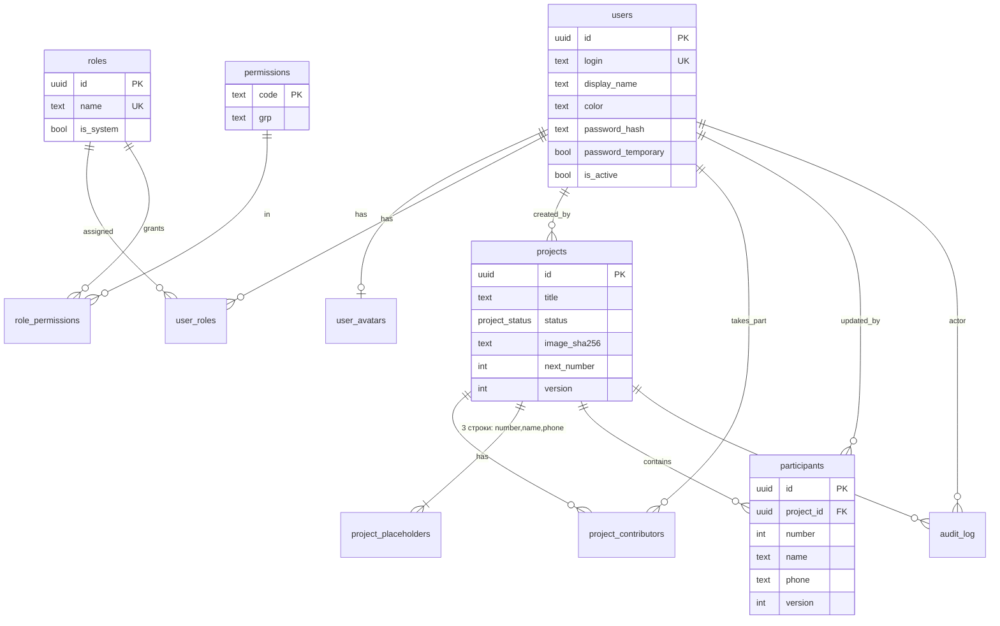

# 03. База данных

PostgreSQL 18 (нужен `uuidv7()`; на 16/17 — генерируем UUIDv7 в Go, схема не меняется).
Миграции — goose (`backend/migrations/NNNNN_name.sql`, `-- +goose Up/Down`), версия в таблице `goose_db_version`.
Доступ — `database/sql` + pgx stdlib, чистый SQL. Время — `timestamptz` (UTC).

## 1. ER-диаграмма

> Полная интерактивная ERD со всеми колонками — [07-erd.md](07-erd.md) (плагин Obsidian). Ниже — краткая версия в Mermaid (рендерится и на GitHub).



## 2. Миграции (DDL)

### 00001_users.sql
```sql
-- +goose Up
CREATE TABLE users (
    id                   uuid PRIMARY KEY DEFAULT uuidv7(),
    login                text        NOT NULL UNIQUE
                         CHECK (login ~ '^[a-z0-9._-]{3,32}$'),            -- всегда нижний регистр
    display_name         text        NOT NULL CHECK (char_length(display_name) BETWEEN 1 AND 80),
    color                text        NOT NULL DEFAULT '#6cb4ff' CHECK (color ~ '^#[0-9a-fA-F]{6}$'),
    locale               text        NOT NULL DEFAULT 'ru'   CHECK (locale IN ('ru', 'uz')),             -- язык интерфейса
    theme                text        NOT NULL DEFAULT 'dark' CHECK (theme IN ('dark', 'light', 'system')), -- тема, по умолчанию тёмная
    -- PHC-строка argon2id: необратимый хэш с солью и параметрами (пароль в открытом или шифрованном виде НЕ хранится)
    password_hash        text        NOT NULL,
    -- пароль выдан сервером (создание пользователя / сброс): UI рекомендует сменить его на свой; не блокирует работу
    password_temporary   boolean     NOT NULL DEFAULT true,
    is_active            boolean     NOT NULL DEFAULT true,
    last_login_at        timestamptz,
    created_at           timestamptz NOT NULL DEFAULT now(),
    updated_at           timestamptz NOT NULL DEFAULT now()
);

-- Аватар ≤ 256×256 JPEG (~20–40 КБ): в БД, чтобы жить в одной транзакции и в одном дампе.
CREATE TABLE user_avatars (
    user_id    uuid PRIMARY KEY REFERENCES users ON DELETE CASCADE,
    mime       text        NOT NULL,
    data       bytea       NOT NULL CHECK (octet_length(data) <= 262144),
    sha256     text        NOT NULL,            -- для ETag и ?v=
    updated_at timestamptz NOT NULL DEFAULT now()
);

-- Токенов в Postgres НЕТ: access и refresh — JWT (HS256), их состояние (allow-list refresh, отзыв) живёт только в Redis.
-- См. 02-architecture.md, 4.1.

-- +goose Down
DROP TABLE user_avatars; DROP TABLE users;
```

### 00002_rbac.sql
```sql
-- +goose Up
-- Каталог прав задаётся КОДОМ (domain/permission.go); при старте tipd upsert'ит его сюда (SyncPermissions),
-- чтобы админ-панель могла его показывать, а role_permissions — ссылаться на существующие коды.
CREATE TABLE permissions (
    code        text PRIMARY KEY CHECK (code ~ '^[a-z_]+\.[a-z_]+$'),     -- 'participant.edit'
    grp         text NOT NULL,                                            -- группа для UI: 'Проекты', 'Участники', …
    description text NOT NULL
);

CREATE TABLE roles (
    id          uuid PRIMARY KEY DEFAULT uuidv7(),
    name        text        NOT NULL UNIQUE CHECK (char_length(name) BETWEEN 2 AND 50),
    description text        NOT NULL DEFAULT '' CHECK (char_length(description) <= 300),
    is_system   boolean     NOT NULL DEFAULT false,     -- admin, worker: нельзя удалить; admin нельзя править
    created_at  timestamptz NOT NULL DEFAULT now(),
    updated_at  timestamptz NOT NULL DEFAULT now()
);

CREATE TABLE role_permissions (
    role_id    uuid NOT NULL REFERENCES roles ON DELETE CASCADE,
    permission text NOT NULL REFERENCES permissions ON DELETE CASCADE,
    PRIMARY KEY (role_id, permission)
);

-- Пользователь может иметь несколько ролей; эффективные права = объединение.
CREATE TABLE user_roles (
    user_id uuid NOT NULL REFERENCES users ON DELETE CASCADE,
    role_id uuid NOT NULL REFERENCES roles ON DELETE RESTRICT,   -- занятую роль не удалить (ROLE_IN_USE)
    PRIMARY KEY (user_id, role_id)
);
CREATE INDEX user_roles_role_idx ON user_roles (role_id);

-- Эпоха прав: растёт при любом изменении ролей/прав/назначений. Access-JWT с меньшей эпохой (claim pe)
-- отклоняется 401 TOKEN_STALE и прозрачно обновляется. Единственная строка; копия держится в памяти процесса.
CREATE TABLE authz_state (
    id    smallint PRIMARY KEY DEFAULT 1 CHECK (id = 1),
    epoch bigint   NOT NULL DEFAULT 1
);
INSERT INTO authz_state DEFAULT VALUES;

-- Системные роли. Права admin и дефолтные права worker расставляет SyncPermissions при первом старте
-- (admin — всегда все права каталога; worker — дефолт из docs/02-architecture.md, 5.2, только если у роли ещё нет прав).
INSERT INTO roles (name, description, is_system) VALUES
    ('admin',  'Полный доступ. Права синхронизируются с каталогом автоматически.', true),
    ('worker', 'Оператор: работа с участниками и печать. Права можно менять.',    true);

-- +goose Down
DROP TABLE authz_state; DROP TABLE user_roles; DROP TABLE role_permissions; DROP TABLE roles; DROP TABLE permissions;
```

### 00003_projects.sql
```sql
-- +goose Up
CREATE TYPE project_status AS ENUM ('active', 'finished');

CREATE TABLE projects (
    id           uuid PRIMARY KEY DEFAULT uuidv7(),
    title        text           NOT NULL CHECK (char_length(title) BETWEEN 1 AND 120),
    status       project_status NOT NULL DEFAULT 'active',
    finished_at  timestamptz,
    -- картинка (файл в uploads/projects/<sha256>); все поля null или все заданы
    image_sha256 text,
    image_name   text,
    image_mime   text,
    image_w      int,
    image_h      int,
    image_bytes  int,
    -- печать
    next_number  int            NOT NULL DEFAULT 1,     -- счётчик номеров; номера не переиспользуются
    version      int            NOT NULL DEFAULT 1,
    created_by   uuid           REFERENCES users ON DELETE SET NULL,
    created_at   timestamptz    NOT NULL DEFAULT now(),
    updated_at   timestamptz    NOT NULL DEFAULT now(),
    CONSTRAINT image_all_or_none CHECK (
        (image_sha256 IS NULL) = (image_w IS NULL) AND (image_w IS NULL) = (image_mime IS NULL))
);
CREATE INDEX projects_status_idx ON projects (status, created_at DESC);

-- 3 строки на проект: number | name | phone. Таблица (а не jsonb) — чтобы CHECK'и защищали целостность.
CREATE TABLE project_placeholders (
    project_id   uuid     NOT NULL REFERENCES projects ON DELETE CASCADE,
    key          text     NOT NULL CHECK (key IN ('number', 'name', 'phone')),
    font         text     NOT NULL,                                  -- из белого списка в приложении
    size         int      NOT NULL CHECK (size BETWEEN 6 AND 400),
    stroke       int      NOT NULL DEFAULT 0 CHECK (stroke BETWEEN 0 AND 50),
    color        text     NOT NULL CHECK (color ~ '^#[0-9a-fA-F]{6}$'),
    stroke_color text     NOT NULL CHECK (stroke_color ~ '^#[0-9a-fA-F]{6}$'),
    bold         boolean  NOT NULL DEFAULT false,
    italic       boolean  NOT NULL DEFAULT false,
    underline    boolean  NOT NULL DEFAULT false,
    x            int      NOT NULL CHECK (x >= 0),                   -- px исходного изображения, центр текста
    y            int      NOT NULL CHECK (y >= 0),
    PRIMARY KEY (project_id, key)
);

-- Кто работал в проекте (аватары на карточке). НЕ влияет на доступ.
CREATE TABLE project_contributors (
    project_id    uuid        NOT NULL REFERENCES projects ON DELETE CASCADE,
    user_id       uuid        NOT NULL REFERENCES users ON DELETE CASCADE,
    first_seen_at timestamptz NOT NULL DEFAULT now(),
    last_seen_at  timestamptz NOT NULL DEFAULT now(),
    PRIMARY KEY (project_id, user_id)
);
CREATE INDEX project_contributors_user_idx ON project_contributors (user_id);

-- +goose Down
DROP TABLE project_contributors; DROP TABLE project_placeholders; DROP TABLE projects; DROP TYPE project_status;
```

### 00004_participants.sql
```sql
-- +goose Up
CREATE TABLE participants (
    id         uuid PRIMARY KEY DEFAULT uuidv7(),
    project_id uuid               NOT NULL REFERENCES projects ON DELETE CASCADE,
    number     int                NOT NULL CHECK (number > 0),
    name       text               NOT NULL DEFAULT '' CHECK (char_length(name)  <= 200),
    phone      text               NOT NULL DEFAULT '' CHECK (char_length(phone) <= 40),
    version    int                NOT NULL DEFAULT 1,            -- optimistic concurrency
    updated_by uuid               REFERENCES users ON DELETE SET NULL,
    created_at timestamptz        NOT NULL DEFAULT now(),
    updated_at timestamptz        NOT NULL DEFAULT now(),
    UNIQUE (project_id, number)                                   -- он же индекс выборки по проекту
);
-- Поиск по имени/телефону: проект ≤ ~20 тыс. строк, клиент фильтрует локально, серверный ILIKE по
-- индексу project_id достаточен. Если понадобится — pg_trgm GIN (name, phone) отдельной миграцией.

-- Выделение номеров атомарно:
--   UPDATE projects SET next_number = next_number + $n WHERE id = $1 RETURNING next_number - $n AS first;
--   INSERT INTO participants (project_id, number) SELECT $1, g FROM generate_series($first, $first+$n-1) g;

-- +goose Down
DROP TABLE participants;
```

### 00005_audit.sql
```sql
-- +goose Up
-- Диск сервера всего 10 ГБ, поэтому аудит хранится недолго: AUDIT_RETENTION_DAYS (30) и AUDIT_MAX_ROWS (100 000),
-- что наступит раньше. ~300 байт на строку, с индексами ≲ 60 МБ. Пишем только изменения и только ID (без ПДн).
CREATE TABLE audit_log (
    id         bigint GENERATED ALWAYS AS IDENTITY PRIMARY KEY,
    at         timestamptz NOT NULL DEFAULT now(),
    actor_id   uuid        REFERENCES users ON DELETE SET NULL,
    actor_login text       NOT NULL,                 -- снимок: логин остаётся читаемым после удаления
    action     text        NOT NULL,                 -- 'user.create', 'project.finish', 'tickets.print', …
    project_id uuid        REFERENCES projects ON DELETE SET NULL,
    entity_id  uuid,
    meta       jsonb       NOT NULL DEFAULT '{}',    -- только ID и числа; БЕЗ имён/телефонов
    ip         inet
);
CREATE INDEX audit_at_idx      ON audit_log (at DESC);
CREATE INDEX audit_project_idx ON audit_log (project_id, at DESC) WHERE project_id IS NOT NULL;

-- +goose Down
DROP TABLE audit_log;
```

## 3. Хранилище файлов

```
$DATA_DIR/uploads/projects/<sha256[0:2]>/<sha256>        # оригинал картинки проекта
$DATA_DIR/tmp/                                           # загрузки до проверки (чистится при старте)
```
* **Content-addressed**: имя = sha256 содержимого → дедупликация, вечный кэш (`Cache-Control: immutable`, ETag = sha), безопасные имена.
* Запись: tmp → `fsync` → `rename`. В БД — только метаданные.
* **GC сирот** раз в сутки: файлы без ссылок в `projects.image_sha256` старше 24 ч удаляются.
* Лимиты: ≤ 10 МБ, ≤ 16 Мпикс; больше 4096 px по длинной стороне — уменьшается при загрузке (лимит canvas на iOS);
  при замене картинки другого размера координаты и размеры плейсхолдеров масштабируются пропорционально.
* Перед записью — проверка свободного места (`MIN_FREE_DISK_MB`).
* Удаление проекта: транзакция БД, затем удаление файла, если на него больше никто не ссылается.

## 4. Служебные задачи (внутри `tipd`, `time.Ticker`)

| Задача | Период | Действие |
|---|---|---|
| Очистка аудита | 1 сутки | Удалить записи старше `AUDIT_RETENTION_DAYS` (30) и сверх `AUDIT_MAX_ROWS` (100 000) — пачками по 5 000 (`DELETE … WHERE id IN (SELECT id … LIMIT 5000)`), чтобы не блокировать таблицу |
| GC файлов | 1 сутки | см. выше |
| `VACUUM`/`ANALYZE` | autovacuum | дефолты достаточны |

## 5. Настройки Postgres под ограниченные ресурсы

`shared_buffers=32MB`, `work_mem=4MB`, `max_connections=20` (на сервере всего 2 ГБ RAM), `max_wal_size=256MB`, `min_wal_size=64MB` (диск сервера — 10 ГБ),
`log_min_duration_statement=300ms` (медленные запросы → Loki), `log_connections=off`.
Пул приложения: `SetMaxOpenConns(10)`, `SetMaxIdleConns(5)`, `SetConnMaxLifetime(30m)`.

## 6. Соответствие старой БД (для справки; данные не переносим)

| Десктоп (`main.*`) | Веб |
|---|---|
| `clients(id, name, phone_number, status bool)` | `participants` (+ `number`, `version`; флаг `status` не переносится — в интерфейсе его нет) |
| `font_settings` (3 строки: позиция/шрифт/цвет/размер/жирный) | `project_placeholders` (+ обводка, курсив, подчёркивание), **на проект** |
| `image(base64 bytea)` | файл в `uploads/`, метаданные в `projects` |
| `advanced_settings_passwords` (3 пароля на опасные действия) | заменено ролью `admin` + подтверждением в UI + аудитом |

## Миграции после первой версии

| Миграция | Что делает |
|---|---|
| `00006_user_palette_colors.sql` | Перекрашивает пользователей, остававшихся на общем цвете по умолчанию, детерминированно по палитре |
| `00007_spread_shared_colors.sql` | Разносит цвета пользователей, делящих один цвет палитры (самый старый сохраняет свой, выбранные вручную не трогаются) |
| `00008_project_position.sql` | `projects.position` — общий для команды порядок проектов (заполняется по `created_at` от новых к старым); новые проекты идут первыми |
| `00009_fonts.sql` | Таблица `fonts` (свои шрифты; файл лежит в blobfs по хэшу), ссылка из плейсхолдеров `custom:<uuid>` |
