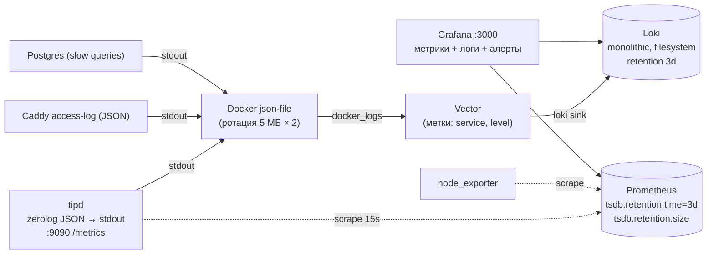

# 05. Наблюдаемость, ресурсы и эксплуатация

Требования: система наблюдаема; ресурсы (RAM/CPU) и диск сильно ограничены; логи и метрики хранятся
**последние 3–5 дней, настраиваемо** (`OBS_RETENTION_DAYS`, по умолчанию **3**: на сервере всего **10 ГБ диска**, см. раздел 6.1).

## 1. Выбранная схема

Подбрано под реальное железо: **2 vCPU, 2 ГБ RAM, HDD 10 ГБ** (отчёт о ПК). Решение по логам: **Loki + Vector + Grafana** (ELK отклонён, см. ниже).



**Метрики — Prometheus** (встроенный скрейпер, ретенция двумя флагами: `--storage.tsdb.retention.time=${OBS_RETENTION_DAYS}d` и потолок `--storage.tsdb.retention.size`).
Серий несколько тысяч, лимит ≈ 128 МБ достаточен.

**Логи — Loki + Vector, смотрим в Grafana (Kibana не нужна).**
* **Почему не ELK:** Elasticsearch требует heap ≥ 512 МБ (контейнер ≈ 1 ГБ, образ ≈ 1,2 ГБ) и активно читает/пишет случайным доступом — на сервере с 2 ГБ RAM и HDD он не помещается
  вместе с Postgres, Redis, Prometheus и Grafana и привёл бы к свопингу и падениям. Замена Kibana на Grafana остаётся: один интерфейс для метрик и логов.
* **Loki** в монолитном режиме (`-target=all`), хранилище — файловая система (индекс TSDB + сжатые чанки), одна тенант-схема (`auth_enabled: false`), кэши выключены,
  лимит контейнера ≈ 256 МБ (`GOMEMLIMIT=200MiB`). **Ретенция:** `compactor.retention_enabled: true` и `limits_config.retention_period: ${OBS_RETENTION_DAYS}d`
  (конфиг читает переменную при старте, `-config.expand-env=true`) — смена срока = смена переменной и `docker compose up -d`. Лимиты приёма (`ingestion_rate_mb`, `per_stream_rate_limit`) защищают от «шторма» логов.
* **Vector** (≈ 40–50 МБ) вместо Promtail (устарел) и Grafana Alloy (тяжелее): источник `docker_logs`, разбор JSON, отбрасывание шума (`/healthz`, статика), отправка в Loki.
  **В метки (лейблы) выносим только `service` и `level`** — Loki индексирует метки, а не текст, поэтому высококардинальные поля (`request_id`, `user_id`, `route`) остаются внутри JSON-строки и ищутся через `| json`.
* **Grafana:** источник данных Loki работает «из коробки», рядом — Prometheus. Примеры запросов LogQL:
  * `{service="tipd"} | json | level="error"` — ошибки;
  * `{service="tipd"} | json | request_id="01JC…"` — вся цепочка одного запроса;
  * `{service="tipd"} | json | dur_ms > 300` — медленные запросы;
  * `sum by (route) (rate({service="tipd"} | json | status >= 500 [5m]))` — 5xx по маршрутам из логов.
  Есть фильтры по полям, гистограмма по времени, live tail и сохранённые запросы; из дашборда метрик можно перейти к логам того же интервала.
* **Ограничение Loki:** retention только по времени, нет общего потолка «не больше X ГБ». Страховки при диске 10 ГБ: короткая ретенция (3 дня), лимиты приёма, сэмплинг шумных `WARN` в приложении,
  отсутствие INFO-шума, алерт на свободное место и `MIN_FREE_DISK_MB`. Если станет тесно — `OBS_RETENTION_DAYS=2` или замена Loki на ещё более лёгкий VictoriaLogs.

Порты UI (Grafana, Prometheus, Loki) наружу не публикуются: Grafana — за Caddy с авторизацией (или SSH-туннель/VPN).

> Версии и точные имена настроек Loki/Vector/Grafana сверяем с актуальной документацией через `context7` в Фазе 6.

## 2. Логи

**Формат** (одна строка JSON на событие):
```json
{"ts":"2026-11-07T10:11:12.345Z","level":"INFO","msg":"http","request_id":"01JC…","method":"PATCH",
 "route":"/api/v1/participants/{id}","status":200,"dur_ms":12,"bytes":311,"user_id":"…","role":"worker","ip":"203.0.113.7"}
```
* В `route` — **шаблон маршрута**, а не фактический путь (низкая кардинальность, нет ID в метриках).
* Всегда: `request_id`, `user_id`, `role`; для WS — `ws_conn`, `project_id`.
* **Запрещено логировать:** пароли, JWT и refresh-токены (и заголовок `Authorization`, cookie), имена и телефоны участников, тело запросов. Тест-«сторож» в CI проверяет, что тестовые значения ПДн не появляются в выводе логгера.
* Уровни: `ERROR` (требует реакции), `WARN` (деградация: медленный WS-клиент, rate-limit), `INFO` (запросы, старт/остановка, бизнес-события), `DEBUG` (по умолчанию выключен).
* Медленные запросы: SQL > 300 мс → `WARN` с именем запроса (не текстом параметров).
* Панику ловит middleware: `ERROR` + stack + request_id, клиенту — 500 без деталей.
* Клиентские ошибки (`POST /client-errors`) попадают в тот же поток с `source=browser`, `ua`, `release`.

**Логгер — `rs/zerolog` (вместо `log/slog`):**
* Только JSON, типизированные поля без рефлексии, практически 0 аллокаций на событие → минимальная нагрузка на GC и CPU.
* **Неблокирующая запись:** вывод в stdout через `zerolog/diode` (кольцевой буфер 8192 события, сброс раз в 10 мс). Медленный stdout/Docker
  не тормозит обработку запросов; при переполнении события отбрасываются, а коллбэк увеличивает `tip_log_dropped_total` (алерт при росте).
* **Сэмплинг шума:** `BurstSampler` для повторяющихся `WARN` (rate-limit, медленный WS-клиент, конфликты локов) — первые 5 в секунду, дальше каждое 10-е
  с полем `sampled`. `ERROR` и аудит-события не сэмплируются.
* **Логгер запроса:** middleware `handler/http` кладёт в `context` логгер с `request_id`, `user_id`, `role`; им пользуются только `handler` и фоновые задачи `main`
  (см. правило Clean Architecture: `domain`/`service`/`repository` не логируют, возвращают ошибки). Ошибка логируется один раз — в `handler`.
* Сторонний код (`net/http.Server.ErrorLog`, `goose`, при необходимости pgx tracelog) перенаправляется в тот же логгер через тонкую обёртку в `platform/logging`.
* Поля именуются константами (`platform/logging/fields.go`): единые имена в логах, LogQL-запросах и дашбордах.

**Хранение:** Loki, retention на compactor (см. раздел 1). Docker json-file на каждом контейнере: `max-size=5m`, `max-file=2`
(буфер на случай, пока Vector/Loki недоступны).
**Объём:** INFO-логи `/healthz`, `/readyz`, статики не пишем; access-log API ≈ 300–500 байт на запрос. Для десятков операторов — порядка
50–300 МБ/сутки до сжатия; Loki сжимает чанки в несколько раз — ожидаем ≲ 0,2–0,5 ГБ за 3 дня (проверить замером в Фазе 6).

## 3. Метрики

| Группа | Метрики (префикс `tip_`) |
|---|---|
| HTTP | `http_requests_total{route,method,status}`, `http_request_duration_seconds` (histogram), `http_in_flight`, `http_response_bytes` |
| WebSocket | `ws_connections`, `ws_rooms`, `ws_messages_in_total{type}`, `ws_messages_out_total{type}`, `ws_slow_client_disconnects_total`, `ws_locks_active`, `ws_lock_conflicts_total` |
| БД | `db_open_connections`, `db_in_use`, `db_wait_count_total`, `db_wait_seconds_total`, `db_query_duration_seconds{query}` (histogram, `query` — категория оператора, см. раздел 9) |
| Бизнес | `logins_total{result}`, `token_refresh_total{result}` (в т.ч. `reuse_detected`, `idempotent_replay`), `blacklist_checks_total{result}` (`ok`/`revoked`/`error`), `blacklist_check_duration_seconds`, `redis_up`, `participants_written_total`, `tickets_printed_total`, `uploads_total{kind,result}`, `rate_limited_total{kind}` |
| Диск и данные | `uploads_bytes`, `data_dir_free_bytes`, `db_size_bytes` (кэш 60 с, см. раздел 9) |
| Рантайм | стандартные `go_*`, `process_*` (горутины, GC, RSS), `build_info{version,commit}`, `log_dropped_total` (события, потерянные неблокирующим логгером) |
| Хост | `node_exporter` (CPU, память, диск, файловая система) |

Скрейп каждые 15 с. Кардинальность контролируем: только шаблоны маршрутов, без `user_id`/`project_id` в лейблах.

**Диагностика:** `pprof` на `:9090` (heap/goroutine/cpu), только во внутренней сети.

## 4. Ретенция — все места, где копятся данные

| Что | Где | Срок | Настройка |
|---|---|---|---|
| Логи приложений и инфраструктуры | Loki (compactor retention) | 3 дня | `OBS_RETENTION_DAYS` |
| Метрики | Prometheus TSDB | 3 дня + `retention.size=300MB` | `OBS_RETENTION_DAYS` |
| stdout-буфер Docker | json-file | 10 МБ на контейнер (`max-size=5m`, `max-file=2`) | `max-size`/`max-file` |
| Refresh allow-list (`rt:*`), отзыв цепочек (`revfam:*`) | Redis (AOF) | 30 д | `REFRESH_TOKEN_TTL` |
| Чёрный список access (`bl:jti:*`) | Redis (AOF) | остаток жизни токена (≤ 15 мин) | `ACCESS_TOKEN_TTL` |
| Отсечки пользователей (`bl:user:*`) | Redis (AOF) | 30 д + 60 с | `REFRESH_TOKEN_TTL` |
| Аудит-лог (бизнес-данные) | Postgres | **30 дней или 100 000 строк** (что раньше), ≲ 60 МБ | `AUDIT_RETENTION_DAYS`, `AUDIT_MAX_ROWS` |
| Бэкапы БД и uploads | `backups/` | 3 дампа БД + 1 снимок `uploads/` | `BACKUP_KEEP` |
| Orphan-файлы | `uploads/` | 24 ч | — |
| Картинки проектов | `uploads/` | пока проект существует; потолок суммарно 800 МБ | `UPLOADS_MAX_TOTAL_MB` |

## 5. Бэкапы

* Ночью (`backup`-контейнер, cron): `pg_dump -Fc` → `backups/db-YYYYMMDD.dump`, снимок каталога `uploads/` (одна копия, перезаписывается: картинки неизменяемы).
* Дампы БД — **3** копии (`BACKUP_KEEP`), снимок `uploads/` — одна актуальная копия (картинки неизменяемы); перед записью проверка свободного места (при нехватке бэкап пропускается с алертом, а не забивает диск).
* **Redis не бэкапим:** потеря данных = все входят заново (безопасность не страдает, см. `02-architecture.md`, 4.1). В Postgres токенов нет — дамп их не содержит.
* **Вне сервера (Q6: хранилища пока нет, но оно нужно):** после ночного бэкапа `rclone` выгружает дамп БД и снимок `uploads/` в удалённое хранилище **с шифрованием на стороне сервера** (`rclone crypt`:
  в бэкапах персональные данные участников, провайдер видеть их не должен). Провайдер подключается конфигом (`BACKUP_REMOTE`), код к нему не привязан. Варианты, доступные из РФ: **S3-совместимое облако**
  (Yandex Object Storage, VK Cloud, Selectel) — рекомендуется: копейки за гигабайты, версионирование и lifecycle на стороне облака (хранить ≈ 14 копий, на сервере места нет); SFTP на другой сервер;
  либо **pull-схема** — ваш компьютер или офисная машина по SSH забирает копии (`rsync`/`restic`). Ключ шифрования хранится **у владельца, отдельно от сервера** (без него бэкап не восстановить — его копия обязательна).
* Мониторинг: метрика `backup_last_success_timestamp{target="local|offsite"}`, алерт и красная плашка в админ-панели, если последняя успешная выгрузка старше 36 ч. Восстановление из внешнего бэкапа проверяется в Фазе 8 (restore drill).
* Восстановление проверяется в Фазе 8 (скрипт `deploy/backup/restore.sh` + ранбук); результат занести в `docs/runbook.md`.

## 6. Бюджет ресурсов (сервер: **2 vCPU, 2 ГБ RAM, HDD 10 ГБ**)

### 6.0 Память (RAM)

| Сервис | Лимит | Комментарий |
|---|---|---|
| ОС + Docker daemon | ≈ 350 МБ | минимальный дистрибутив без лишних сервисов (оценка) |
| `tipd` | 96 МБ (`GOMEMLIMIT=80MiB`) | пик на загрузку картинки ≤ 10 МБ, семафор на декодирование = 2, argon2id (19 МиБ) — не более 2 одновременных |
| PostgreSQL | 160 МБ | `shared_buffers=32MB`, `max_connections=20`, `work_mem=4MB` |
| Redis | 32 МБ (`maxmemory 24mb`) | токены, единицы тысяч ключей |
| Caddy | 32 МБ | |
| Prometheus | 128 МБ | скрейп 15 с, несколько тысяч серий |
| Loki | 256 МБ (`GOMEMLIMIT=200MiB`) | монолитный режим, кэши выключены |
| Vector | 48 МБ | |
| Grafana | 192 МБ | плагины и аналитика отключены |
| node_exporter | 16 МБ | |
| backup (cron + pg_dump + rclone) | 64 МБ | только во время ночного бэкапа |
| **Итого контейнеры** | **≈ 1,0 ГБ** (сумма `mem_limit` = 1024 МБ) | |
| **С ОС** | **≈ 1,4 ГБ из 2 ГБ** | запас ≈ 0,7 ГБ на пики |

* Каждому контейнеру задан `mem_limit`; при нехватке памяти первыми должны страдать Grafana/Loki, а не `tipd`/Postgres (в compose — `oom_score_adj` выше у наблюдаемости).
* Своп на HDD губителен: вместо файла подкачки включаем **zram** (≈ 512 МБ сжатой памяти) как страховку, `vm.swappiness` низкий.
* Grafana держим включённой: через неё работают алерты (раздел 7). Если RAM когда-нибудь не хватит, её можно останавливать (≈ 190 МБ), а алерты вынести в Prometheus + Alertmanager (+30 МБ).
* **Общий сервер.** Если на хосте живут и другие проекты, Loki, Vector и Grafana запускаются профилем `obs` и по умолчанию выключены (набор по умолчанию: сумма `mem_limit` = 528 МБ), см. [08-ci-cd.md](08-ci-cd.md).
* **CPU:** 2 vCPU хватает; тяжёлое — argon2id (ограничен семафором) и декодирование картинок (ограничено). **HDD:** избегаем частых `fsync`-нагрузок вне Postgres (`checkpoint_timeout=15min`, `wal_compression=on`), логи и метрики пишутся последовательно (Loki/Prometheus это умеют), Elasticsearch с его случайным I/O отклонён.

### 6.1 Диск (всего **10 ГБ**)

| Статья | Размер | Комментарий |
|---|---|---|
| ОС + Docker engine | ≈ 3,0 ГБ | |
| Docker-образы | ≈ 1,4 ГБ | tipd ≈ 25 МБ, Caddy, Postgres alpine, Redis, Prometheus, node_exporter, **Loki ≈ 0,1 ГБ, Vector ≈ 0,1 ГБ**, Grafana ≈ 0,4 ГБ (оценка, сверить `docker image ls`) |
| PostgreSQL (данные + WAL) | ≈ 0,3 ГБ | `max_wal_size=256MB`; аудит ≲ 60 МБ |
| Картинки проектов (`uploads/`) | ≤ 0,8 ГБ | потолок `UPLOADS_MAX_TOTAL_MB`; при превышении — `507 DISK_LOW` |
| Prometheus | ≤ 0,3 ГБ | 3 дня + `retention.size` |
| Loki (логи) | ≤ 0,5 ГБ | 3 дня, чанки сжаты |
| Docker json-file | ≤ 0,1 ГБ | `max-size=5m`, `max-file=2` на контейнер |
| Бэкапы | ≤ 0,9 ГБ | 3 дампа БД (небольшие, сжаты) + **1** снимок `uploads/` (картинки неизменяемы, копия одна и обновляется) |
| **Свободный резерв** | **≈ 2,7 ГБ** | алерт при < 1,5 ГБ |
| **Итого** | **10 ГБ** | |

* Замена Elasticsearch на Loki освободила ≈ 2 ГБ диска и ≈ 1 ГБ RAM. Резерв позволяет при необходимости поднять потолок картинок, но тогда растёт и снимок в бэкапе.
* Аудит — бизнес-данные, но тоже ограничен: 30 дней **и** 100 000 строк (что раньше), удаление пачками раз в сутки; в аудит пишем только изменения (не чтения) и только ID, без ПДн.
* Картинки проектов при загрузке уменьшаются до 4096 px; удалённый проект сразу освобождает файл (GC).

**Защита диска:** `retention.size` Prometheus, retention и лимиты приёма Loki, ротация Docker-логов, `MIN_FREE_DISK_MB` (загрузки отклоняются с 507), потолки `UPLOADS_MAX_TOTAL_MB` и `AUDIT_MAX_ROWS`, ограниченное число бэкапов.

## 7. Дашборды и алерты

* **Grafana** (провижининг из файлов `deploy/grafana/`, дашборды — код в git): «Обзор» (RPS, p95, 5xx, WS, пул БД, RSS, диск),
  «Realtime» (WS-соединения, конфликты локов, медленные клиенты), «Логи» (Explore по Loki: ошибки, медленные SQL,
  `request_id`-поиск, клиентские ошибки браузера).
* **Алертинг (Фаза 6; Telegram с сервера в РФ недоступен — Q7):** Grafana-managed alerts по метрикам Prometheus и логам Loki (без Alertmanager, дополнительной памяти не нужно).
  Каналы: **e-mail по SMTP** российского провайдера (Яндекс 360, Mail.ru для бизнеса или корпоративная почта; только служебные письма админу) и/или **webhook** (бот VK Teams, Max);
  плюс **красная плашка и список проблем в админ-панели** (`/admin/system`, «Состояние») — работает вообще без внешних сервисов. Правила:
  `readyz` недоступен 2 мин · `redis_up == 0` или рост `blacklist_checks_total{result="error"}` · 5xx > 2 % за 5 мин · свободно на диске < 1,5 ГБ (15 %) · RSS `tipd` > 90 % лимита · `ws_slow_client_disconnects_total` или `log_dropped_total` растут · бэкап старше 36 ч ·
  Loki недоступен или Vector не доставляет логи.
* Внешний «пинг» `/healthz` (любой доступный из РФ сервис мониторинга или cron-скрипт на вашем ПК) — самый дешёвый способ узнать, что упал весь хост: Grafana и плашка работают на том же сервере и вместе с ним падают.

## 8. Чек-лист приёмки наблюдаемости

- [ ] Любой запрос прослеживается по `request_id` от access-log до SQL-лога.
- [ ] В логах нет ПДн (автотест).
- [ ] Данные старше `OBS_RETENTION_DAYS` реально удаляются (проверено на ускоренном сроке).
- [ ] После 7 суток работы под нагрузкой диск в пределах бюджета (раздел 6.1): `df` ≤ 85 %, аудит ≤ 100 000 строк, Loki ≤ 0,5 ГБ.
- [ ] Остановка Postgres/Loki не роняет `tipd`: логи в stdout продолжают идти (Vector догонит из json-file); `readyz` отражает состояние БД.
- [ ] Смена `OBS_RETENTION_DAYS` применяется перезапуском (Loki и Prometheus читают новое значение при перезапуске).
- [ ] Выход, деактивация и смена пароля делают токен недействительным немедленно (e2e-тест с Redis); поведение при остановке Redis соответствует `REDIS_FAIL_MODE` (login/refresh/logout — всегда 503); пересоздание Redis с пустыми данными разлогинивает всех один раз и ничего не ломает.
- [ ] Контейнеры укладываются в лимиты памяти из раздела 6.0 (≈ 1,4 ГБ с ОС из 2 ГБ) под нагрузочным тестом, без свопинга.
- [ ] Ранбук: «диск заполняется», «WS-клиенты отваливаются», «медленные запросы», «забыт пароль админа» (`tipd admin reset-password`).

## 9. Статус реализации метрик

Реализованы все метрики раздела 3:
`tip_http_*` (запросы, длительность, in-flight, `tip_http_response_bytes{route}` — гистограмма размера ответа), `tip_db_*` (пул), `tip_build_info`, `tip_log_dropped_total`,
`tip_ws_*` (соединения, комнаты, сообщения, медленные клиенты, конфликты локов, `tip_ws_locks_active`), `tip_redis_up`, `tip_blacklist_checks_total{result=ok|revoked|error}`,
`tip_blacklist_check_duration_seconds`, `tip_logins_total`, `tip_token_refresh_total{result=ok|idempotent_replay|reuse_detected|invalid|error}`,
`tip_participants_written_total`, `tip_tickets_printed_total`, `tip_uploads_total{kind=project_image|avatar,result=ok|rejected|error}`,
`tip_rate_limited_total{kind=login|client_errors|api|ws}`, `tip_db_query_duration_seconds{query}`, `tip_uploads_bytes`, `tip_data_dir_free_bytes`, `tip_db_size_bytes`.

Где что считается и чем реализация отличается от текста раздела 3:
* **`token_refresh_total`:** `ok` — обычная ротация; `idempotent_replay` — повтор уже использованного refresh внутри окна повтора (10 с), клиенту отдаётся тот же новый токен; `reuse_detected` — повтор после окна, цепочка закрыта (клиент получает тот же `REFRESH_INVALID`); `invalid` — прочие отказы (подпись, срок, закрытая цепочка, пользователь деактивирован); `error` — сбой хранилища токенов. Различает исходы сам `service.Auth` и сообщает через `AuthDeps.OnRefresh`.
* **`db_query_duration_seconds{query}`:** метка `query` — **категория оператора** (`select`, `insert`, `update`, `delete`, `tx` для begin/commit/rollback, `other`), а не имя запроса: измеряется на уровне драйвера (трассировщик pgx в `platform/db`), текст SQL в метки не попадает. Поимённая метка потребовала бы правок каждого запроса во всех репозиториях.
* **`ws_messages_*_total`:** метка называется `type`, а не `t` (как в коде); дашборд «Realtime» приведён к `type`.
* **`rate_limited_total`:** HTTP-ответы 429 считаются в middleware метрик по шаблону маршрута (`login` — `/auth/login`, `client_errors` — `/client-errors`, остальное — `api`); `ws` — отказы лимитера кадров соединения.
* **`participants_written_total`:** успешные создание, правка и импорт строк (удаление не считается); **`tickets_printed_total`:** число ID в успешном `POST …/participants/printed`. Счётчики ставят декораторы в `cmd/tipd/adapters_metrics.go`, сервисы метрик не знают.
* **Диск и данные:** `tip_data_dir_free_bytes` (syscall, при каждом скрейпе), `tip_uploads_bytes` (обход `DATA_DIR/uploads`) и `tip_db_size_bytes` (`pg_database_size`) считаются при скрейпе, но кэшируются на 60 с, общий таймаут пересчёта — 2 с; при ошибке сохраняется последнее значение, а если замера ещё не было, серия не публикуется (нет ложного нуля). Раз в 5 мин из раздела 3 заменено кэшем на 60 с.

Дашборд `deploy/grafana/dashboards/business.json` («TIP Business and Data») показывает новые метрики; алерты по ним пока не заведены (кандидаты: рост `reuse_detected`, `rate_limited_total{kind="login"}`, `tip_data_dir_free_bytes`).
